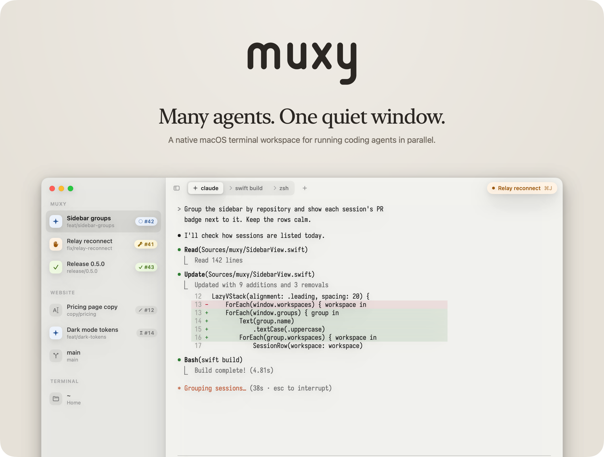
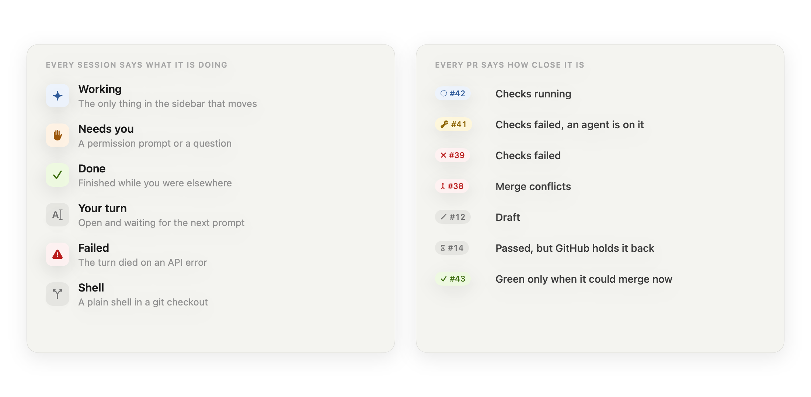
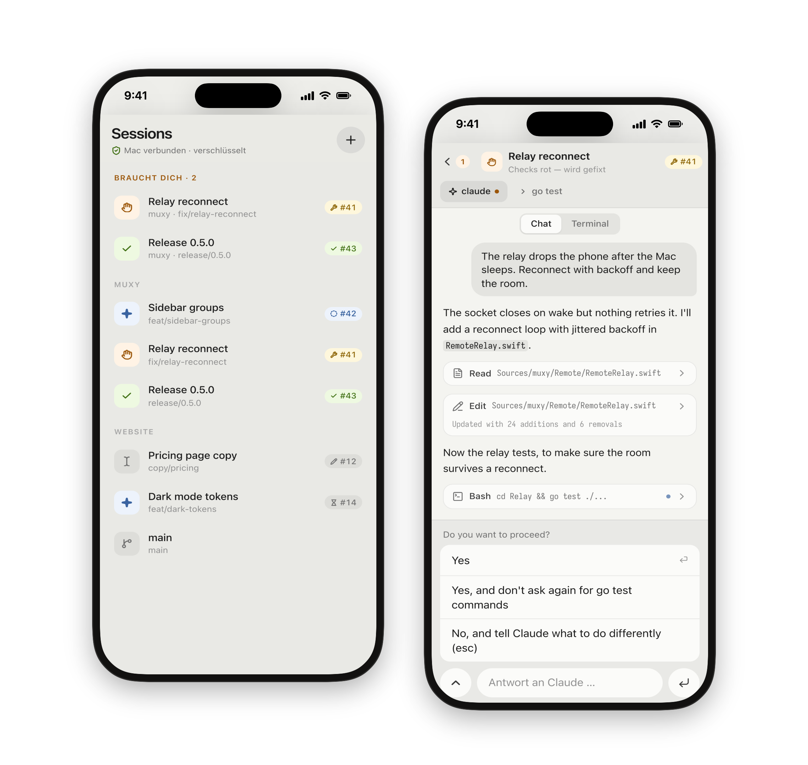

<p align="center">
  <picture>
    <source media="(prefers-color-scheme: dark)" srcset=".github/readme/poster-dark.png">
    
  </picture>
</p>

<p align="center">
  Real Ghostty rendering, every session in one window,<br>
  and a calm signal the moment one of them needs you.
</p>

<p align="center">
  <a href="#install"><b>Install</b></a>&nbsp;&nbsp;·&nbsp;&nbsp;<a href="https://github.com/theitger/muxy/releases/latest">Download</a>&nbsp;&nbsp;·&nbsp;&nbsp;<a href="#on-your-phone">On your phone</a>&nbsp;&nbsp;·&nbsp;&nbsp;<a href="#keys">Keys</a>&nbsp;&nbsp;·&nbsp;&nbsp;<a href="#command-line">Command line</a>
  <br>
  <sub>macOS 14 or later&nbsp;&nbsp;·&nbsp;&nbsp;MIT licensed</sub>
</p>

<br>

## Real Ghostty, a calm frame

Muxy embeds [libghostty](https://ghostty.org) and loads your own
`~/.config/ghostty/config`: font, opacity, padding, keys, all of it.
Around it sits one quiet neutral palette, greys with color only where
it means something (waiting, running, failed), and the terminal wears
the same neutral pair by default. Settings → Terminal colors gives you
your Ghostty theme back, and Terminal font picks any monospaced font and
size, or keeps Ghostty's.

## A session is what used to be a window

`⌘N` opens one. `cd` somewhere and start your agent; `⌘T` opens a tab
right there. The sidebar groups sessions by repository and shows branch
and pull request on its own. Nothing to configure.

Drag a session out of the sidebar and drop it anywhere: it becomes its own
window, right there. Drop it on another window's sidebar and it moves in.
Running processes don't notice.

## Know which agent needs you

<picture>
  <source media="(prefers-color-scheme: dark)" srcset=".github/readme/signals-dark.png">
  
</picture>

A hook in Claude Code and in Codex reports *working*, *done* and *needs
you* for every tab. The session's card changes, the Dock shows a count, and
when Muxy is in the background a banner appears: answer it right there
(a reply, or one of the choices the agent's prompt offers) or click it and
you're in that session.

The inbox (`⇧⌘J`, or the pill in the title bar) lists everything waiting on
you across all windows: blocked agents first, then failed turns, then news,
oldest first. Each row shows the last lines, the prompt's choices as
buttons and a reply line, so you answer without leaving what you're in.
`⌘J` walks the same list.

## See what it came to, and try it

When a turn ends, the session's **result** (`⌘I`) says in plain words what
the agent did, whether tests ran and passed, how many files changed, and
the PR with its CI checks. No diff to read.

If the session runs a web server (its own dev server, or one in a container
on the ports its worktree got), the card shows the port and **App :3000**
above the terminal opens it beside the terminal; `⌥`-click opens the
browser. Several servers: a menu, web pages first.

Start from an issue: type `#123` (or its link) into `⌘N`. Muxy looks it up,
names the branch after it and asks the agent to close it from the PR.

The PR badge follows the CI checks and GitHub's merge state: blue while
checks run, yellow when they failed and something in the session is
working on it, red when they failed or the PR has conflicts, grey for
drafts and PRs GitHub still holds back (review, out-of-date branch,
required check missing). Green only when it could be merged right now.

## Proven, not claimed

An agent saying "tests pass" is a claim. After every turn Muxy runs the
repository's own checks on the agent's work itself, only those whose files
changed, and the result says both: what the agent claims and what Muxy
found. A failed check lights up the session; **Send failures to the agent**
hands it the command and the end of its output. Checks are sections in
`.wtconfig`:

```ini
[check "frontend"]
    run = cd frontend && pnpm run check
    paths = frontend/
[check "backend"]
    run = make test
    paths = backend/
    auto = false        # only on request and when landing
```

Without any, the test command [quorum](https://github.com/yungweng/quorum)
gates its fixes with is used, on request. The same files are never checked
twice: results are kept per tree. Agents can prove their own work before
they say they're done: `muxy proof` inside a Muxy terminal waits for the
checks and exits non-zero when one fails.

## Every turn, and the way back

Muxy keeps the files as they were before and after every turn as hidden
git refs (`refs/muxy/turns/…`: no commits on your branch, nothing pushed).
The result lists the turns; one click shows what a turn changed, another
puts the files back to it (and keeps the state you left as a turn of its
own, so going back can be undone).

**Changes** (`⇧⌘D`) shows the last turn, the whole branch or any turn as
a diff. Hover a line, write what the agent should change there, collect
comments across files, and send them as one message: each comment at its
`file:line`, the line quoted.

## Collisions before they happen

Five agents in five worktrees of one repository will step on each other.
Muxy merges every session's files with every other's, and with the branch
they will land on, in git's object store (`git merge-tree`: nothing is
checked out, a check takes milliseconds) whenever a turn ends and every
minute and a half. A session that would conflict says with whom and in
which files, long before a pull request; **Tell the agent** asks it to keep
those changes small, or to merge the base in now.

## quorum, built in

[quorum](https://github.com/yungweng/quorum) is a panel of reviewers
that finds what's wrong in a pull request, fixes it and waits for CI.
Muxy installs it for you (Settings → Review with quorum, in a terminal
you can watch), sets what matters there (engines, effort, reviewers,
posting, auto-merge, its background agent) without touching the rest of
its config, shows each session's run on its card and the result, and
lists every run in the hub's **Reviews**: running first, with findings,
the report, the PR and a second try.

## Land

**Land** takes a session's pull request the rest of the way: everything
committed, up to date with its base (merged in when that is clean), the
checks, a push, quorum's review-and-fix loop when it is installed, then
GitHub's auto-merge with the repository's own merge method. Wherever a step
needs thought (uncommitted work, a real conflict, a failing check) it goes
back to the agent with exactly that, and landing resumes when its turn
ends; after three rounds it stops and leaves it to you. When the PR is
merged, the session closes and its worktree goes.

## Side by side

Pick **Both** in `⌘N` (or `muxy new --agent both`) and Claude and Codex
work on the same task, each in its own worktree on its own branch. The
hub shows them next to each other with their checks and collisions; **Keep**
closes the other and removes its worktree, its branch stays.

## The hub

`⇧⌘H` (or **Hub** in the title bar) puts all work on one board: the
issues GitHub has assigned to you across your repositories (`ready-for-agent`
first) and pull requests waiting for your review, then every session as it
moves through working, in review and ready to land. An issue starts with
one click, in its own worktree, on a branch named after it, with the agent
asked to close it from the PR. GitHub is reached through `gh`: its login is
Muxy's; signed out, the hub offers to sign in.

**Worktrees** lists every worktree of your repositories, whoever made it:
Muxy, a Claude Code subagent, quorum or you by hand. Each with its branch,
PR, uncommitted changes, unmerged commits, age and running containers, and
whether it can go without losing anything. **Remove finished** takes all of
those at once. Containers a worktree shares with the main checkout (the
same Compose project name) are never stopped with it.

## On your phone

<picture>
  <source media="(prefers-color-scheme: dark)" srcset=".github/readme/phone-dark.png">
  
</picture>

Settings → Phone shows a QR code. Scan it and Safari becomes a remote for
every session: the sidebar with agent states and PR badges, Claude as a
chat with permission buttons, any tab's screen with a line to type into and
the keys a phone lacks. It works on the same Wi-Fi, or from anywhere
through your own relay (`Relay/`, a small server Muxy connects out to).
The phone app speaks English, or German on a German phone.

Pairing puts a secret on the phone, and every connection is end-to-end
encrypted with it (fresh X25519 keys, ChaCha20-Poly1305). "Pair Again"
locks all phones out.

## Light and dark

Muxy follows the system, or stays light or dark (Settings → Appearance).
Terminals switch along with it: the neutral pair, or your Ghostty
config's `theme = light:…,dark:…` when you chose your theme.

## The quiet details

- **Keeps the Mac awake.** Optional, in Settings: while Muxy runs the Mac
  doesn't sleep, lid closed included, so agents keep working and the phone
  keeps reaching them. Asks for your password once. Quitting Muxy, or
  Muxy dying, turns it off; below 20 % battery the Mac may sleep again.
- **Built to stay fast.** Exactly one terminal surface per window is
  attached; background sessions keep their PTY but cost no rendering. No
  animations while idle. One `gh` call per repository keeps every PR badge
  current, and polling pauses when GitHub rate-limits.
- **Quick terminal.** Optional, in Settings: a shell drops down from the top
  of the screen on a global key (`` ⌃` ``, `⌥Space` or `` ⌥⌘` ``), from any app.
- **Find in the scrollback.** `⌘F`, then `⌘G` / `⇧⌘G`.
- **Updates itself.** Checks once a day and asks before installing.
- **English or German.** English by default; switch in Settings (`⌘,`).

## Install

```sh
brew tap theitger/tap
brew trust theitger/tap        # Homebrew ≥ 6 requires tap trust
brew install --cask muxy
```

The app is ad-hoc signed (no Apple Developer certificate), so the cask
clears the quarantine flag after installing; otherwise Gatekeeper would
block the first launch as "unverified developer". Installing the zip by
hand instead needs `xattr -dr com.apple.quarantine /Applications/Muxy.app`.

**Updates.** Muxy checks for a new version once a day and asks before it
installs; *Muxy → Check for Updates…* checks right away, Settings turns the
daily check off. Updates come from this repository's releases and are
verified with an EdDSA signature ([Sparkle](https://sparkle-project.org)).
Muxy 0.4.0 and earlier can't update themselves: `brew upgrade --cask muxy`
once.

<details>
<summary><b>Build from source</b></summary>
<br>

```sh
git clone https://github.com/theitger/muxy && cd muxy
./Scripts/make-app.sh   # fetches the pinned GhosttyKit and Sparkle binaries, builds ~/Applications/Muxy.app
```

For a bare `swift build`, run `./Scripts/fetch-ghostty.sh` and
`./Scripts/fetch-sparkle.sh` once. `MUXY_APP_DIR` builds the app elsewhere.

**Releasing:** `./Scripts/setup-updates.sh` once (creates the update
signing key in your keychain), then bump the version and build number in
`Packaging/Info.plist` and run `./Scripts/make-release.sh`; upload both
`dist/Muxy-<version>.zip` and `dist/appcast.xml` to the GitHub release.
With `MUXY_SIGN_IDENTITY` (a Developer ID Application identity) and
`MUXY_NOTARY_PROFILE` (from `xcrun notarytool store-credentials`) the app
is signed with the hardened runtime and notarized.

Requires macOS 14+, Xcode 15+ command line tools. If Ghostty.app is
installed, its shell integration and terminfo are bundled into Muxy.

</details>

## Setup

1. **Agent status:** the first launch walks you through it (again any
   time from Settings or the Help menu). Muxy copies its hook to
   `~/.local/share/muxy/agent-hook.sh` and adds it to Claude Code's
   `settings.json` and Codex's `hooks.json`, leaving everything else in
   them untouched, and keeps it current after updates. The hook is a no-op
   outside Muxy. Codex runs a new hook only once you trust it: type
   `/hooks` in codex once. The hooks also tell Muxy each conversation's id,
   so sessions come back after a restart. Without the app:
   `./Scripts/install-claude-hook.sh` and `./Scripts/install-codex-hook.sh`
   do the same.
2. **Worktrees** (optional): a `.wtconfig` in a repository tells Muxy how
   a new worktree becomes ready to work in: ignored files to copy, ports
   of its own, its own Compose project, a bootstrap command, a teardown.
   See `Sources/muxy/Worktrees.swift`. Muxy keeps one such worktree ready
   per repository, so a new session starts at once.
3. **`muxy` on your PATH** (optional): Settings → Command line tool links
   it into `~/.local/bin` (or, from a checkout,
   `ln -s "$PWD/Scripts/muxy" ~/.local/bin/muxy`). Then `muxy .` opens a
   session in the current directory; see [Command line](#command-line) for
   the rest. Folders dropped on the Dock icon do the same.

## Keys

| Key | Action |
| --- | --- |
| `⌘N` | new session: task, repository, agent, own worktree |
| `⌥⌘N` | new shell in home |
| `⇧⌘N` | new window |
| `⌘T` | new tab in the current tab's directory |
| `⌘W` | close tab → the last tab closes the session → an empty window closes |
| `⌘1…9` · `⌃Tab` | switch tab |
| `⌃1…9` · `⌘⌥↑/↓` | switch session |
| `⌘J` | next session that wants you (any window) |
| `⇧⌘J` | inbox: everything waiting on you, answerable in place |
| `⌘I` | the session's result: proof, turns, collisions, quorum, land |
| `⇧⌘D` | changes: last turn, whole branch or any turn, with line comments |
| `⇧⌘H` | the hub: issues, sessions in flight, worktrees |
| `⌘F` · `⌘G` · `⇧⌘G` | find in the scrollback |
| `⌘K` | search sessions |
| `⌘B` | show/hide the sidebar (drag its edge to resize) |

Closing a window ends its sessions (confirmed if something runs); `⌘Q`
confirms too. Muxy keeps running without windows: click the Dock icon.

## Command line

`muxy` lets scripts, other tools and the agents themselves start sessions
and report into them. Muxy knows nothing about who calls it.

```sh
muxy [dir]                     # a session in dir (default: here)
muxy new [options] [prompt]    # like ⌘N; prints the new session's id
muxy notify [--session <id>] [--title <t>] <message>
muxy status [--json]           # every open session
muxy focus <id>                # that session on stage, Muxy in front
muxy proof [--session <id>]    # run the checks, wait, exit 1 on failure
muxy land [--session <id>]     # land the session's pull request
```

- **`new`**: `--repo <dir>` (default: the current folder), `--agent
  claude|codex|both|none` (both: side by side, each in its own worktree), `--worktree` / `--no-worktree`, `--branch <name>`,
  `--issue <ref>`; the rest is the task (`-` reads it from stdin). What you
  leave out follows the ⌘N panel's last choices. Starts Muxy if it isn't
  running.
- **`notify`**: the session's card lights up with the message, a toast
  shows it, and a banner too while Muxy is in the background. Every Muxy
  terminal has `MUXY_SESSION`, so an agent or a script running in one just
  calls `muxy notify "ready for review"`. Outside a session it's a plain
  toast.
- **ids**: a session's id from `muxy status`, or any of its tabs' ids
  (`$MUXY_SESSION`); a unique start of either is enough.
- **Exit status**: 0 done, 1 Muxy refused (the reason goes to stderr),
  2 bad usage, 3 Muxy isn't running or didn't answer within
  `MUXY_TIMEOUT` seconds (default 10).

`muxy status --json` prints:

```json
{
  "version": 1,
  "sessions": [
    {
      "id": "7750688E-FB04-4CF0-9459-EDF42B5FD483",
      "window": 1,
      "onStage": true,
      "title": "Fix the flaky login test",
      "repo": "app",
      "branch": "fix/login-flake",
      "directory": "/Users/me/src/app/.worktrees/fix-login-flake",
      "folder": "fix-login-flake",
      "agent": "claude",
      "state": "working",
      "attention": false,
      "notice": null,
      "pr": {
        "number": 12, "state": "open", "checks": "pending", "draft": false,
        "mergeable": "unknown", "status": "running"
      },
      "tabs": [
        { "id": "998D046D-7752-4D91-9E7B-A37AD8AA49C2", "agent": "claude",
          "state": "working", "directory": "/Users/me/src/app/.worktrees/fix-login-flake",
          "attention": false }
      ]
    }
  ]
}
```

| Key | Values |
| --- | --- |
| `window` | 1-based, in Muxy's window order |
| `repo`, `branch`, `agent`, `notice`, `pr` | `null` when there is none |
| `agent` | `claude`, `codex` |
| `state` | `none`, `idle`, `working`, `blocked` (needs you), `failed` (API error) |
| `attention` | something happened you haven't seen yet |
| `notice` | the last `muxy notify` message, until you look |
| `pr.state` | `open`, `merged`, `closed` |
| `pr.checks` | `none`, `pending`, `failed`, `passed` |
| `pr.mergeable` | `unknown`, `clean`, `conflicting`, `behind`, `reviewRequired`, `changesRequested`, `blocked` |
| `pr.status` | the badge: `none`, `running`, `fixing`, `failed`, `conflicts`, `draft`, `waiting`, `ready`, `merged`, `closed` |

Keys are only ever added; `version` goes up if one changes meaning.

How it talks to Muxy: each request is a small JSON file renamed into
`~/.local/state/muxy/commands`, and the answer comes back the same way in
`replies`. Muxy only picks from these fixed actions and runs nothing a file
says; files that aren't yours, are too big, malformed or older than 30
seconds are dropped. A development build (`swift run`) listens in
`~/.local/state/muxy-dev` instead and sets `MUXY_STATE_DIR` in its own
terminals, so `muxy` there reaches it and everywhere else the installed
app. Set `MUXY_STATE_DIR` yourself to run an instance on the side.

## Under the hood

- SwiftUI + AppKit shell around `libghostty` (via
  [libghostty-spm](https://github.com/Lakr233/libghostty-spm), vendored and
  pinned under `Vendor/` with two small patches marked `muxy patch`; the
  ~50 MB GhosttyKit binary is fetched at build time, checksum-verified).
- Ghostty's exec backend spawns your login shell per tab: real PTY, real
  VT, no custom terminal code in this repo.
- The working directory (OSC 7) and command exit codes (OSC 133) come from
  the shell; repository, branch, PR and its checks are derived from them with
  `git` and `gh` (checks re-polled every minute).
- The chrome has its own neutral palette (zinc greys) and
  [Lucide](https://lucide.dev) icons (ISC), drawn from their SVG source.
  With your Ghostty theme chosen for the terminal, the strip above it
  still takes the terminal's background, parsed from your theme files.

## Credits & license

MIT © Tristan Heitger. Muxy stands on
[Ghostty](https://ghostty.org) by Mitchell Hashimoto (MIT) and
[libghostty-spm](https://github.com/Lakr233/libghostty-spm) by
[@Lakr233](https://github.com/Lakr233) (MIT, license included under
`Vendor/`), and updates itself with [Sparkle](https://sparkle-project.org)
(MIT). Not affiliated with the Ghostty project.

<br>

<p align="center">
  <picture>
    <source media="(prefers-color-scheme: dark)" srcset=".github/readme/icon-dark.png">
    
  </picture>
</p>
